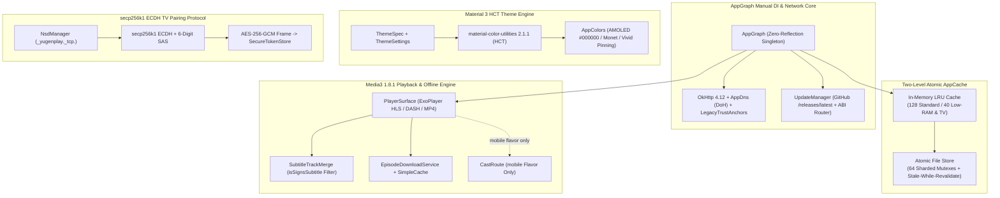

# Yugen Play

**Native Android & Android TV Anime Streaming Client — Public Architecture Showcase & Release Host**

[-3DDC84?style=for-the-badge&logo=android&logoColor=white)](https://developer.android.com/tv)

> [!IMPORTANT]
> **Two-Repository Architecture Notice:** The core application source code (`811` Kotlin files across `43` packages, internal media resolvers, and `355` unit test suites) is maintained in a private repository. This public repository serves as the **official showcase, public architectural specification hub, issue tracker, and signed APK release host** powering Yugen Play's in-app `UpdateManager`.

---

## 1. Download Latest Releases (`UpdateManager` Host)

Signed builds for **Mobile** and **Android TV** (supporting Android 5.1 / Fire OS 5 `API 22` through `API 36`) are published on the [**Releases Latest**](https://github.com/ZenX-Soumyadeep/Yugen-Play/releases/latest) page.

| Form Factor | Target ABI | Release Artifact | Download |
| :--- | :--- | :--- | :--- |
| **Android Mobile** | Universal (`arm64-v8a` + `armeabi-v7a`) | `YugenPlay.apk` | [**Download Latest Mobile APK**](https://github.com/ZenX-Soumyadeep/Yugen-Play/releases/latest/download/YugenPlay.apk) |
| **Android Mobile** | 64-bit ARM (`arm64-v8a`) | `YugenPlay_arm64-v8a.apk` | [**Releases Tab**](https://github.com/ZenX-Soumyadeep/Yugen-Play/releases/latest) |
| **Android Mobile** | 32-bit ARM (`armeabi-v7a`) | `YugenPlay_armeabi-v7a.apk` | [**Releases Tab**](https://github.com/ZenX-Soumyadeep/Yugen-Play/releases/latest) |
| **Android TV / Fire TV** | Universal (`arm64-v8a` + `armeabi-v7a`) | `YugenPlay_tv.apk` | [**Download Latest TV APK**](https://github.com/ZenX-Soumyadeep/Yugen-Play/releases/latest/download/YugenPlay_tv.apk) |
| **Android TV / Fire TV** | 64-bit ARM (`arm64-v8a`) | `YugenPlay_tv_arm64-v8a.apk` | [**Releases Tab**](https://github.com/ZenX-Soumyadeep/Yugen-Play/releases/latest) |
| **Android TV / Fire TV** | 32-bit ARM (`armeabi-v7a`) | `YugenPlay_tv_armeabi-v7a.apk` | [**Releases Tab**](https://github.com/ZenX-Soumyadeep/Yugen-Play/releases/latest) |

> [!NOTE]
> Both `mobile` and `tv` product flavors share `applicationId = "com.zenx.yugen.play"` while isolating Google Cast (`androidx.media3:media3-cast`) exclusively to the `mobile` build so Android TV / Fire TV installs stay lean and free of Play Services Cast crashes.

---

## 2. High-Level System Architecture

---

## 3. Architectural Specifications & Public Contracts

### 3.1 Architecture Documentation (`docs/architecture/`)

| Subsystem | Specification Document | Key Technical Highlights |
| :--- | :--- | :--- |
| **DI & Startup** | [`Arch_AppGraph_DI.md`](docs/architecture/Arch_AppGraph_DI.md) | Zero-reflection `AppGraph`, hardware/RAM sensing, `AppDns` DoH, API 22–25 trust anchors |
| **Playback & Offline** | [`Arch_Playback_and_Media3.md`](docs/architecture/Arch_Playback_and_Media3.md) | Media3 `1.8.1`, `SimpleCache` foreground downloads, `isSignsSubtitle`, gesture HUD |
| **Material 3 Theming** | [`Arch_Theme_and_M3_Design.md`](docs/architecture/Arch_Theme_and_M3_Design.md) | `material-color-utilities` `2.1.1` HCT schemes, AMOLED `#000000`, Vivid primary pinning |
| **Auth & TV Pairing** | [`Arch_Auth_and_TV_Pairing.md`](docs/architecture/Arch_Auth_and_TV_Pairing.md) | mDNS `_yugenplay._tcp.`, ephemeral `secp256k1` ECDH, 6-digit SAS, AES-256-GCM + PKCE |

### 3.2 Public Kotlin Contracts & Build Topology

| Artifact | Purpose |
| :--- | :--- |
| [`YugenArchitectureSpec.kt`](src/main/kotlin/com/zenx/yugen/play/YugenArchitectureSpec.kt) | Release constants (`2.0.0`, build `100`), sealed architectural contracts, system metrics |
| [`YugenCommitLedger.kt`](src/main/kotlin/com/zenx/yugen/play/YugenCommitLedger.kt) | Chronological build evolution ledger synchronized with the private repository |
| [`app/build.gradle.kts`](app/build.gradle.kts) | Sanitized Gradle build topology (`compileSdk 36`, `minSdk 22`, `mobile` / `tv` flavors, ABI splits) |
| [`gradle/libs.versions.toml`](gradle/libs.versions.toml) | Authoritative dependency version catalog |
| [`.gitattributes`](.gitattributes) | GitHub Linguist overrides ensuring accurate Kotlin language classification |

---

## 4. Technology Stack Matrix

| Layer | Technology | Version |
| :--- | :--- | :--- |
| **Language** | Kotlin | `2.1.21` |
| **UI Toolkit** | Jetpack Compose + Material 3 | `2024.12.01` (BOM) |
| **Dynamic Color** | MaterialKolor (`material-color-utilities`) | `2.1.1` |
| **Media Engine** | AndroidX Media3 (ExoPlayer, HLS, DASH, Session, Cast) | `1.8.1` |
| **Networking** | OkHttp + DNS-over-HTTPS + Cronet | `4.12.0` / `18.0.1` |
| **Cryptography** | `acinq/secp256k1-kmp` (ECDH & Schnorr) + AES-256-GCM | `0.19.0` |
| **Persistence** | Two-Level Atomic `AppCache` + Jetpack DataStore | `1.1.7` |
| **QR & Background** | Nayuki QRGen + AndroidX WorkManager | `1.8.0` / `2.10.5` |

---

## 5. Issues, Changelogs & Release Verification

- **Bug Reports & Feature Requests:** Open an issue directly on this repository with your device model, Android/Fire OS version, and installed `Yugen Play` build number.
- **Release Integrity:** All official APKs distributed through `UpdateManager` are signed with the project release key; Android enforces signature continuity on every in-app update.

Maintained by **[ZenX-Soumyadeep](https://github.com/ZenX-Soumyadeep)**

