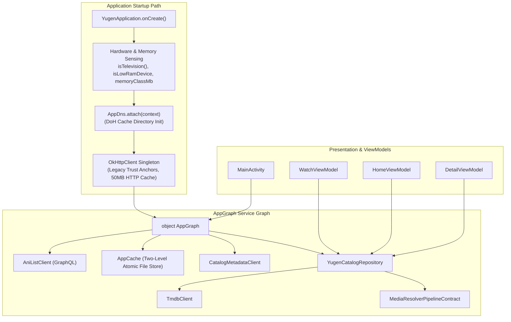

# Architecture: AppGraph Manual DI Container & Startup Lifecycle

> [!NOTE]
> **DI Pattern:** Zero-Reflection Manual Singleton Container  
> **Key Benefits:** Zero annotation-processor build overhead, fast cold start on Android TV SoCs, deterministic unit testing.

---

## 1. Architectural Motivation

Across dual Android form factors (Mobile and Android TV), reflection-heavy or code-generated DI graphs add startup and variant-wiring overhead:

| Engineering Constraint | AppGraph Manual DI Design | Operational Impact |
| :--- | :--- | :--- |
| **Cold Start on TV SoCs** | Single `object AppGraph` initialized synchronously in `Application.onCreate()` | Avoids factory graph reflection on constrained TV processors |
| **Multi-Flavor Isolation** | Form-factor flags (`isTv`) and flavor-scoped dependencies | Eliminates brittle conditional DI components across `mobile` and `tv` |
| **Unit-Test Determinism** | `AppGraph.isReady` readiness guard | Lets JVM unit tests instantiate domain models without mocking DI containers |

---

## 2. Component Topology & Initialization Graph

---

## 3. Core Subsystems Initialized in `AppGraph.init(context)`

### 3.1 Hardware & Environment Sensing
- **`isTv`**: Evaluated at startup via `isTelevision(context)` checking `FEATURE_LEANBACK`, `UI_MODE_TYPE_TELEVISION`, and Fire TV signals, then updated from persisted user layout preferences.
- **`isLowRamDevice` & `memoryClassMb`**: Read from `ActivityManager` so `AppCache` and Coil image caches automatically scale down memory budgets on constrained TV sticks.

### 3.2 Network Pipeline Configuration
- **Custom DNS (`AppDns`)**: Implements `okhttp3.Dns` with DNS-over-HTTPS fallback (Cloudflare / Google) and automatic interception retry.
- **Legacy Trust Anchors (`LegacyTrustAnchors`)**: Bundles updated Let's Encrypt ISRG Root X1 certificates for Android 5.1–7.0 (API 22–25) devices whose system root stores have expired.
- **Shared HTTP Cache**: Configures a 50 MB `okhttp3.Cache` with unified connection timeouts and diagnostics event hooks.

### 3.3 Associated Specifications
- [Media3 Playback & Offline Engine](Arch_Playback_and_Media3.md)
- [Material Design 3 Theming System](Arch_Theme_and_M3_Design.md)
- [Auth & TV mDNS Pairing Protocol](Arch_Auth_and_TV_Pairing.md)
