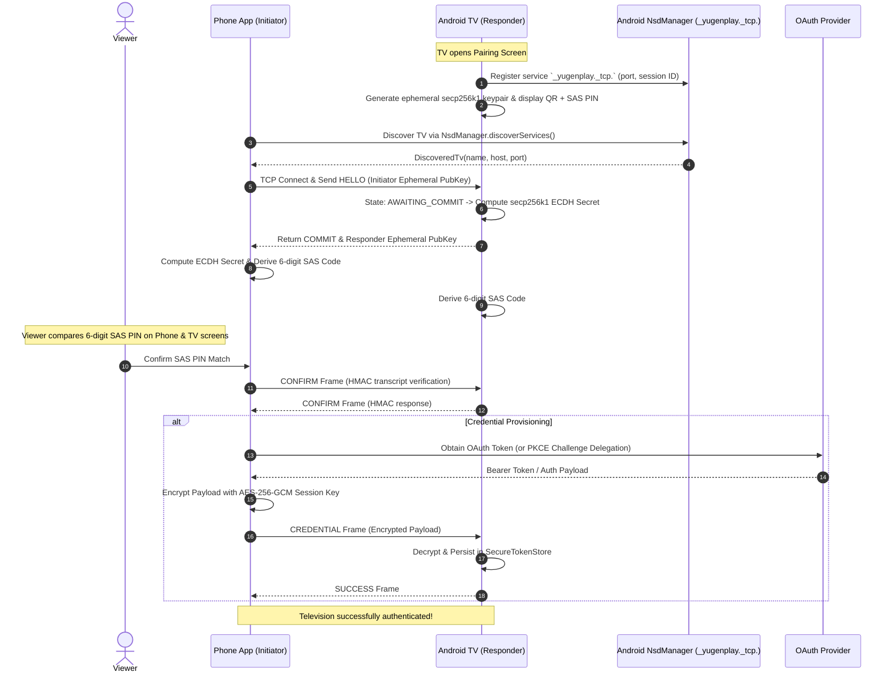

# Architecture: AniList OAuth & TV mDNS Pairing Protocol

> [!NOTE]
> **Pairing Service:** Zero-Configuration mDNS (`_yugenplay._tcp.`)  
> **Key Agreement:** Ephemeral `secp256k1` ECDH + 6-Digit Short Authentication String (SAS)

---

## 1. Complete TV Pairing Protocol Sequence

Entering OAuth credentials with an Android TV D-pad remote is slow and error-prone. Yugen Play implements an end-to-end encrypted local LAN pairing protocol (`yugenplay-pair/1`) enabling a phone to securely provision tracker credentials to an Android TV.

---

## 2. Cryptographic Security Invariants

### 2.1 Zero Cleartext Credentials on Local Network
- mDNS TXT records advertise only protocol version, session ID, and service capabilities — never key material.
- All credentials travel inside AES-256-GCM frames with 12-byte random IVs and Associated Authenticated Data (AAD) derived from the `secp256k1` ECDH session key.

### 2.2 Short Authentication String (SAS) MITM Prevention
- Both 65-byte uncompressed `secp256k1` public keys and both 16-byte nonces are bound into the HKDF transcript before deriving the 6-digit visual SAS code.
- Any active Man-in-the-Middle produces diverging SAS codes on the two screens.

### 2.3 PKCE Delegation for Rotating Refresh Tokens
- For trackers that rotate refresh tokens on every refresh, sharing one token pair across phone and TV would invalidate one device.
- The phone transfers the authorization PKCE parameters so the TV performs its own independent token exchange and maintains a separate session.

### 2.4 Associated Specifications
- [AppGraph Manual DI Container](Arch_AppGraph_DI.md)
- [Material Design 3 Theming System](Arch_Theme_and_M3_Design.md)
