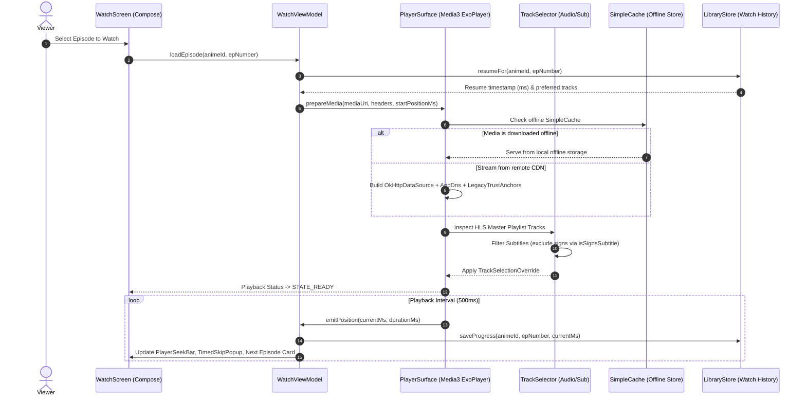

# Architecture: Media3 Playback & Offline Streaming Engine

> [!NOTE]
> **Core Engine:** AndroidX Media3 ExoPlayer `1.8.1`  
> **Supported Formats:** HLS (`m3u8` adaptive bitrate), DASH (`mpd`), Progressive MP4, WebM

---

## 1. Playback Engine Pipeline

The playback engine decouples the Jetpack Compose presentation layer from ExoPlayer internals. `PlayerSurface` manages the video rendering surface, while `WatchViewModel` orchestrates episode loading, track heuristics, offline fallback, and watch-progress persistence.

---

## 2. Advanced Playback Capabilities

### 2.1 Multi-Track Audio & Subtitle Heuristics (`isSignsSubtitle`)
- Releases often include separate English tracks for full dialogue and "Signs & Songs" or forced captions.
- `isSignsSubtitle` inspects track labels and language metadata to prevent auto-selecting signs-only tracks as the default dialogue subtitle.

### 2.2 Offline Downloads (`EpisodeDownloads.kt` & `EpisodeDownloadService.kt`)
- Backed by AndroidX Media3 `DownloadManager`, `SimpleCache`, and `NoOpCacheEvictor`.
- Runs inside a foreground `EpisodeDownloadService` with notification updates to survive background OS termination during multi-episode downloads.

### 2.3 Fluid Gesture HUD (`PlayerGestureControls.kt`)
- **Left Screen Half:** Vertical drag adjusts display brightness.
- **Right Screen Half:** Vertical drag adjusts media stream volume.
- **Horizontal Drag:** Precision scrubbing across episode duration.
- **Double-Tap:** Configurable seek jump forward or backward.

### 2.4 Form-Factor Cast Isolation (`mobile` Flavor Only)
- The `mobile` flavor compiles `androidx.media3:media3-cast` for Chromecast playback.
- The `tv` flavor excludes Google Cast dependencies at build time to keep Leanback and Fire TV APKs compact and free of Play Services Cast initialization errors.

### 2.5 Associated Specifications
- [AppGraph Manual DI Container](Arch_AppGraph_DI.md)
- [Material Design 3 Theming System](Arch_Theme_and_M3_Design.md)
