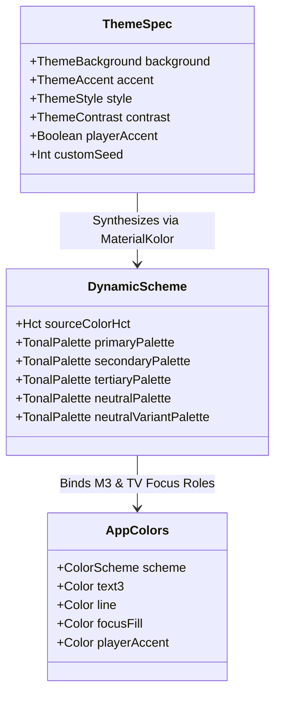

# Architecture: Google Material Design 3 Theming System

> [!NOTE]
> **Design Language:** Google Material Design 3 (Material You)  
> **Color Math Core:** `com.materialkolor:material-color-utilities:2.1.1`

---

## 1. Dynamic Scheme Generation

`AppColorScheme.kt` translates persisted appearance settings (`ThemeSettings.kt`) into a complete Material 3 `ColorScheme` and custom UI tokens (`AppColors`) using Google's HCT (Hue, Chroma, Tone) color space.

---

## 2. Supported Themes & Palettes

| Customization Axis | Supported Options | Engineering Details |
| :--- | :--- | :--- |
| **Canvas Mode** | AMOLED Black (`#000000`), Dark Grey (`#121212`) | Pure `#000000` canvas rebuilds the surface container ladder at tones `4 / 6 / 10 / 14` |
| **Accent Origin** | Monochrome (default), Wallpaper (Android 12+ Monet), 9 Curated HCT Accents, Custom Hex | Monochrome prioritizes legibility on living-room TVs without clashing with artwork |
| **Scheme Style** | `VIVID` (`SchemeFidelity` + pinned primary), `TONAL`, `NEUTRAL`, `VIBRANT` | Vivid prevents M3's default tone-80 pastel washout on saturated accents |
| **Contrast Tier** | `STANDARD` (`0.0`), `MEDIUM` (`0.5`), `HIGH` (`1.0`) | Shifts tone pairs and neutral-variant hairline outlines proportionally |

---

## 3. UI/UX Layout & Motion Standards

- **4dp / 8dp Grid Rhythm:** Components across `ui/components/` and `ui/watch/` align spacing and elevation to a strict 4dp/8dp grid.
- **Accessible Touch & Focus Targets:** Interactive controls enforce a minimum `48dp × 48dp` target box and dedicated TV D-pad focus highlight tokens (`focusFill`, `focusContent`).
- **Smooth Motion Curves:** Overlay transitions use Material 3 emphasized/standard decelerate easing curves suited for high-refresh-rate displays.

### 3.1 Associated Specifications
- [Media3 Playback & Offline Engine](Arch_Playback_and_Media3.md)
- [AppGraph Manual DI Container](Arch_AppGraph_DI.md)
